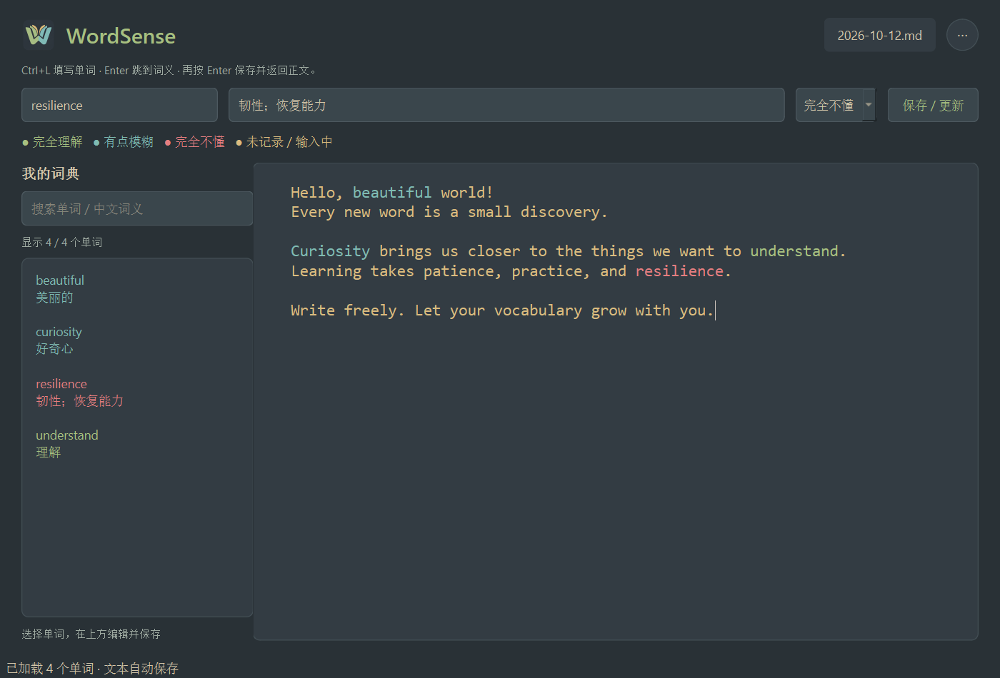

# WordSense 1.0.5

[English](README.md) · **简体中文**

本地优先的 Windows 英语写作与词汇理解标记应用。使用 Python 3.11+、PySide6 和 SQLite；编辑及词库查询不依赖网络 API、账号或服务器。



## 功能

- 实时按 ASCII 英文字母分词，大小写不敏感，保留原文大小写。词库加载到内存，日常输入按受影响的文本块增量高亮。
- 完全理解为绿色 `#A7C080`，有点模糊为蓝色 `#7FBBB3`，完全不懂为红色 `#E67E80`；未记录和输入中的词为黄色 `#DBBC7F`。
- 左侧词典支持英文单词和中文词义的部分检索。保存词条后已有文本立即重新着色。
- 原生选择、复制、粘贴、撤销、重做；Enter 创建新段落并补两个空格，自动软换行不插入字符。多行粘贴批量处理。
- 每日文章保存为 UTF-8 Markdown，支持切换日期、另存为、自定义目录以及迁移后的旧文件清理。
- 所有文章共用一个 SQLite 词库；词库位置也可以独立设置和迁移。
- Ink Slate 主题、书页 W Logo、顶部文档菜单。当前应用界面使用中文，文档提供中英双语。

## 下载 Windows 版

在 [v1.0.5 Release](https://github.com/snowfeeling3/WordSense/releases/tag/v1.0.5) 下载 `WordSense-v1.0.5-Windows-x64.zip`，解压完整文件夹后双击 `WordSense.exe`。无需安装 Python，保留旁边的 `_internal` 文件夹。

不要运行 `build/` 中的中间 EXE，也不要仅复制 EXE。发布包为未签名的 Windows x64 免安装版；附 SHA-256 校验文件、使用说明与第三方组件许可文本。

## 从源码运行

在 Python 3.11+ 环境下执行（PowerShell）：

```powershell
git clone https://github.com/snowfeeling3/WordSense.git
cd WordSense
python -m venv .venv
.\.venv\Scripts\python.exe -m pip install -r requirements.txt
.\.venv\Scripts\python.exe -m wordsense
```

安装完成后也可双击 `start_wordsense.cmd`。根目录的 `WordSense.cmd` 用于启动已下载或构建的 `dist/WordSense-v1.0.5/WordSense.exe`，不是首次克隆时的源码入口。

验证环境：Windows 11、Python 3.13.5、PySide6 6.8.3。源码采用 Qt，但其他系统的完整桌面行为尚未验证。

## 操作

| 操作 | 按键或入口 |
| --- | --- |
| 从正文跳到单词框 | Ctrl+L，选中已有内容便于替换 |
| 单词填写后跳到词义 | 单词框按 Enter |
| 保存词条并返回正文 | 词义框按 Enter，或点击“保存 / 更新” |
| 立即保存文章 | Ctrl+S |
| Markdown 另存为 | Ctrl+Shift+S |
| 切换日期和设置目录 | 顶部右侧圆形“⋯”菜单 |

未完成词暂为黄色，输入分隔符后按当前词库判定；未知词保持黄色。词典理解程度改变后会重新高亮全文。Markdown 只存正文，不保存颜色；历史文章按当前共享词库显示颜色。启动默认打开今天，跨午夜不会自动切换正在写的日期。

## 存储、迁移与备份

默认用户目录：`%LOCALAPPDATA%\WordSense`，与程序和工作目录无关。

- **词库**：`wordsense.sqlite3`。所有日期、源码运行和打包运行共用同一个库。
- **文章**：`documents/YYYY-MM-DD.md`。可通过“设置文档位置…”迁移到其他文件夹。
- **路径配置**：`settings.json` 记录实际词库路径；文章目录设置保存在当前词库的 `app_meta` 表。
- **词库迁移**：通过 SQLite backup 接口备份并校验，保存新路径后清理旧库；不覆盖目标已有词库，配置目标丢失时不会自动创建空替代库。
- **文章迁移**：逐文件复制并校验 SHA-256，成功后清理旧日期文档与应用临时文件，其他文件保留。被占用的旧文件可以稍后重试清理。

词条保存立即提交 SQLite 事务。文章在停止编辑约 700 ms 后由后台线程原子写入；这个计时器只用于保存，不延迟高亮。切换日期和关闭窗口会等待保存完成。强制终止进程可能丢失最后尚未保存的输入。

备份前关闭应用，复制固定配置目录、实际词库目录和实际文章目录。迁移词库后使用本版或更新版本；此前版本不识别自定义词库配置。

旧四级词库的 level=1 会迁移到 level=2：旧“有点印象”和“不太理解”统一为“有点模糊”，单词、词义、ID 和时间戳保留。当前内部值为 3=理解、2=模糊、0=不懂。

## 测试与性能

```powershell
.\.venv\Scripts\python.exe -m unittest discover -s tests -v
.\.venv\Scripts\python.exe -m benchmarks.benchmark
```

当前 48 项自动化测试覆盖颜色判定、编辑边界、长文本粘贴、UTF-16、撤销重做、键盘操作、存储、目录迁移、冲突保护和旧词库转换。测试只使用临时数据库和文档。

历史本机基准：12 万字符、6000 段落粘贴约 74.632 ms；局部两键输入中位数 0.076 ms、P95 0.093 ms，最多处理两个文本块。测试使用 Qt offscreen，不包含屏幕绘制和磁盘 I/O；其他设备可能不同。详见 [英文架构及验证说明](docs/ARCHITECTURE.md)、[原始基准](benchmarks/results.json) 与 [中文验证记录](docs/ARCHITECTURE.md)。

高亮粒度是段落，极长单段落、首次加载和词库全局刷新可能短暂占用主线程。撤销历史和光标位置不跨文档或重启保存。请避免多个旧版/新版实例或外部编辑器同时修改同一文档。

## 构建 Windows 分发包

在 Windows 和 PowerShell 7 下执行：

```powershell
.\.venv\Scripts\python.exe -m pip install -r requirements-build.txt
.\packaging\build.ps1
.\.venv\Scripts\python.exe -m tools.verify_release
```

构建生成包含运行库的免安装目录、ZIP 和校验文件，并执行 EXE 验收。构建产物不进入 Git 历史。第三方许可准备首次运行需要网络，应用编辑功能不需要网络。

## 项目结构与第三方说明

`wordsense/` 为应用源码，`tests/` 为测试，`tools/` 为验证和图标工具，`packaging/` 为 PyInstaller 构建与许可材料，`assets/` 为 Logo，`benchmarks/` 为基准，`docs/` 为说明和验证记录。

配色来源：[Everforest](https://github.com/sainnhe/everforest)。第三方组件说明见 [THIRD_PARTY_NOTICES.txt](packaging/THIRD_PARTY_NOTICES.txt) 和 [许可文本](packaging/licenses)。WordSense 应用源码采用 [MIT 许可证](LICENSE)，第三方组件遵循各自许可。
